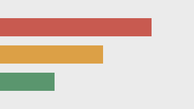

# 城市夜跑的十年变化

- 来源：示例城市周刊
- 发布时间：2026年11月18日，07:30（UTC+0）
- 收录时间：2026年11月19日，21:12（UTC+0）

## 摘要

夜跑从小众爱好变成城市日常，路灯、步道和跑团一起改变了跑步的样子

- 背景：十年前晚上出门跑步的人很少，主要担心照明和安全。
- 变化：滨河步道连成环线以后，晚上七点到九点成了跑步高峰。
- 数据：一个虚构的社区跑团从十二人增加到四百多人。
- 隐忧：步道拥挤、噪声和夜间照明对鸟类的影响开始被讨论。

## 正文

### 一、从「一个人跑」到「一群人跑」

十年前，晚上出门跑步算是一件有点奇怪的事。路灯稀疏，人行道时断时续，跑上两公里就要穿过三个没有信号灯的路口。那时候坚持夜跑的人，多半是白天实在抽不出时间的上班族。

现在情况完全不同了。滨河步道连成了一条十四公里的环线，沿途每隔五百米有一个饮水点，晚上七点到九点，步道上的人比白天还多。


图：一条虚构的滨河夜跑环线，橙色是常见的跑步路线

### 二、改变跑步方式的几样东西

#### 照明

步道改造时把路灯从单侧改成了双侧，亮度不高，但没有暗区。很多跑者说，真正让他们敢在晚上出门的，不是更亮的灯，而是「一路都有灯」。

#### 跑团

社区跑团是另一个变化。一个虚构的「河边慢跑会」最早只有十二个人，现在固定参加周三夜跑的有四百多人。跑团的规矩很简单：

- 不比速度，最慢的人决定配速；
- 每次跑前五分钟热身，跑后十分钟拉伸；
- 雨天照常集合，但只走不跑。

#### 记录工具

手表和手机让记录变得容易。有跑者把每次的距离、心率和天气记在一张表里，十年下来积累了两千多条记录。

> 我后来发现，记录本身不重要，重要的是每次跑完愿意花一分钟回头看一眼。
>
> ——一位跑了十年的读者

### 三、一张对比表

| 项目 | 十年前 | 现在 |
|---|---|---|
| 连续步道长度 | 约 3 公里 | 14 公里 |
| 晚间照明 | 单侧、有暗区 | 双侧、无暗区 |
| 固定跑团 | 1 个 | 9 个 |
| 饮水点 | 无 | 28 个 |

### 四、跑者自己做的小工具

有位跑者写了一段很短的脚本，把每周的跑量汇总成一行，方便贴进笔记里：

```python
def weekly_total(runs):
    # runs: [(日期, 公里数), ...]
    total = sum(km for _, km in runs)
    return f"本周 {len(runs)} 次，共 {total:.1f} 公里"
```



三双跑鞋的鞋底磨损对比丨示意图

### 五、还没解决的问题

步道变热闹之后，新的问题也出现了。傍晚的高峰时段，跑步的人、散步的人和骑车的人挤在同一条三米宽的路上；有居民反映夜跑团经过时太吵；也有研究者提醒，沿河的夜间照明可能会干扰鸟类的作息。

这些问题没有简单的答案。比较现实的做法，是把步道分时段、分车道，再把照明调成朝下、偏暖的颜色。

夜跑的十年，说到底是一座城市慢慢学会在晚上照顾行人的十年。

[阅读原文](https://example.com/weekly/night-run)
