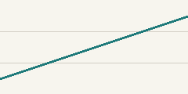

# 低成本温湿度传感器的长期漂移：一年户外对照实验

- 来源：示例实验室技术报告
- 发布时间：2026年10月28日
- 收录时间：2026年11月12日，09:05（UTC+0）

## 摘要

便宜的传感器测温够用，湿度在高湿季节后要重新对照

- 温度漂移每年不到 0.3 度。
- 高湿一周后湿度读数偏高约 4 个百分点。
- 建议每半年对照一次。

## 正文

### 摘要

我们把 12 只低成本温湿度传感器和一台参考仪器放在同一个百叶箱里，连续记录一年。温度读数的漂移每年不到 0.3 度，湿度读数在高湿季节后明显偏高。

### 方法

每只传感器每 10 分钟记录一次，和参考仪器的读数逐条对比。百叶箱放在开阔的草地上，离地 1.5 米。

湿度偏差随月份的变化

### 结果

温度：12 只里有 11 只的偏差一直在 0.3 度以内。湿度：连续一周相对湿度高于 90% 之后，读数平均偏高 4 个百分点，之后几个月慢慢回落。

### 建议

- 每半年和参考仪器对照一次。
- 高湿季节之后单独做一次检查。
- 记录里写明传感器的批次。

[阅读原文](https://example.org/papers/sensor-drift)
